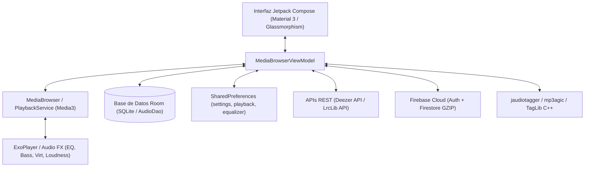
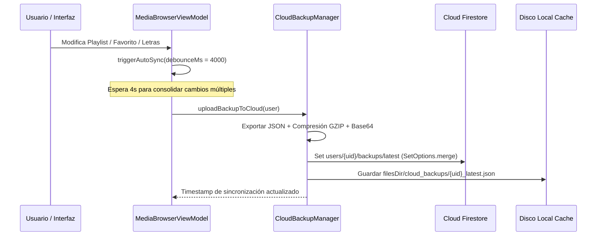

# 🎵 KevMusicPlayer — Contexto General del Proyecto (Single Source of Truth)

Este documento es la **Fuente Única de Verdad (Single Source of Truth)** para el proyecto Android **KevMusicPlayer**, un reproductor de música nativo de alto rendimiento con interfaz moderna en Jetpack Compose, sincronización de biblioteca y respaldo en la nube vía Google Firebase, personalización visual avanzada y soporte de efectos de sonido DSP a 120 FPS.

---

## 1. Propósito y Visión General
**KevMusicPlayer** es un reproductor de audio moderno, ligero y ultrarrápido desarrollado en **Kotlin y Jetpack Compose** para Android 13+ (API 33 a 37+). Su arquitectura está diseñada bajo la filosofía **Local-First**, ofreciendo una experiencia estética, fluida y altamente configurable sin depender de servicios de streaming externos.

### Pilares Funcionales:
1. **Biblioteca Local Inteligente:** Escaneo nativo con `MediaStore` y extracción de metadatos/etiquetas (ID3v1, ID3v2, FLAC, Vorbis, MP4) vía `jaudiotagger` y `mp3agic`.
2. **Sistema de Carga de Carátulas Multi-Nivel:** Arquitectura en 5 niveles de respaldo (RAM LruCache, Disco WebP, `loadThumbnail` acelerado por hardware, `MediaMetadataRetriever` protegido e imágenes de carpeta) con cero bloqueos y protección contra envenenamiento de caché.
3. **Sincronización y Respaldo en la Nube (Google Cloud / Firebase):** Inicio de sesión con Google (`GoogleSignInClient` + `FirebaseAuth`) y almacenamiento comprimido GZIP en Firestore de listas de reproducción, letras de canciones, estadísticas y configuraciones del usuario.
4. **Reproducción y Audio DSP:** Basado en `Jetpack Media3 / ExoPlayer` (`MediaSessionService`) con soporte para reproducción en segundo plano, controles de pantalla de bloqueo, integración de notificación multimedia nativa, ecualizador gráfico de 5 bandas, refuerzo de graves (*Bass Boost*), sonido envolvente virtualizado (*Virtualizer*), normalización de volumen (*ReplayGain*) y salto manual de pista instantáneo.
5. **Letras Sincronizadas y Traducidas:** Visualización y edición en tiempo real de letras sincronizadas (.lrc) o estáticas, con integración de búsqueda automática en línea (LrcLib API) y persistencia local/nube.
6. **Mantenimiento y Diagnóstico:** Herramientas integradas para detectar canciones duplicadas por hash/metadatos, verificar integridad de archivos corruptos, filtrar audios cortos (audios de WhatsApp/tonos) y descargar carátulas faltantes en HD desde Deezer API.
7. **KevMusic Wrapped (Historias Estilo Spotify Wrapped):** Resumen estadístico interactivo a pantalla completa con barras de progreso animadas, aura sonora, hábitos de escucha, arquetipos de personalidad y póster final exportable en PNG.
8. **Personalización Estética Neo-Glow / Glassmorphism:** Temas visuales (*Cyberpunk Rosa, Cyberpunk Púrpura, Azul Petróleo, Turquesa, Obsidiana AMOLED y Monocromo*), soporte de transparencia Glassmorphism en barra de navegación y tarjetas, fondo ambiental dinámico basado en los colores de la carátula, visualizador animado (FFT) y selector de tasa de refresco a **120 Hz**.
9. **Generador y Exportador de Clips de Video (Music Story / Reel):** Renderizado acelerado por hardware (`MediaCodec` H.264 + AAC + `MediaMuxer`) para exportar fragmentos de video (9:16 vertical o 1:1 cuadrado) con música, letras sincronizadas animadas, ondas de audio y carátula con vinilo girando directamente a WhatsApp, Instagram Stories, TikTok o galería.

---

## 2. Stack Tecnológico y Arquitectura



- **Lenguaje:** 100% Kotlin (Coroutines, Flow, StateFlow).
- **UI Framework:** Jetpack Compose con Material 3 (`androidx.compose.material3`), Compose Animation, Compose Foundation, Compose Runtime.
- **Reproducción Multimedia:** `androidx.media3` (`media3-exoplayer`, `media3-session`, `media3-ui`, `media3-common`).
- **Base de Datos Local:** Android Room (`androidx.room:room-runtime`, `androidx.room:room-ktx`, KSP) en versión 11.
- **Backend y Nube:**
  - **Firebase Auth:** Autenticación con Google (`GoogleAuthProvider` + `GoogleSignInOptions`).
  - **Cloud Firestore:** Almacenamiento NoSQL de respaldos en la nube bajo `users/<userId>/backups/latest`.
  - **Firebase Storage / Google Services:** Integrados vía `google-services.json`.
- **Carga y Caché de Imágenes:** Coil Compose (`io.coil-kt:coil-compose`) + `LruCache` en memoria y almacenamiento WebP en disco.
- **Manipulación de Etiquetas:** `jaudiotagger` (`org.jaudiotagger:jaudiotagger:3.0.1`) y `mp3agic` (`com.mpatric:mp3agic:0.9.1`).
- **Consumo de APIs REST:** `OkHttp 4.10.0` y `kotlinx.serialization` (Deezer API, LrcLib API).

---

## 3. Estructura del Proyecto y Archivos Clave

El código fuente se encuentra estructurado modularmente en `app/src/main/java/com/kevshupp/kevmusicplayer/`:

```text
com/kevshupp/kevmusicplayer/
├── MainActivity.kt                      # Contenedor principal, flujo de Onboarding y navegación Navigation3
├── KevMusicPlayerApplication.kt         # Inicialización de Firebase, TelemetryLogger y ciclo de vida global
│
├── data/                               # Capa de Datos y Modelos
│   ├── AudioFile.kt                     # Entidad Room de canción local
│   ├── AudioDao.kt                      # DAO de Room para operaciones CRUD de biblioteca
│   ├── AppDatabase.kt                   # Base de datos SQLite Room (Versión 11)
│   ├── AudioScanner.kt                  # Escaneo inteligente de MediaStore
│   ├── CoverArtRepository.kt            # Búsqueda y descarga de carátulas en HD (Deezer API 1000x1000)
│   ├── ArtistImageHelper.kt             # Búsqueda, caché y filtrado estricto de fotos de artistas (Deezer API)
│   ├── LyricsRepository.kt              # Repositorio de letras sincronizadas (.lrc) y traducciones
│   ├── SongIdentity.kt                  # Remapeo de ids de MediaStore y archivo de canciones huérfanas
│   ├── AppUpdater.kt                    # Comprobador y descargador de actualizaciones vía GitHub Releases
│   ├── TelemetryLogger.kt               # Registro seguro de errores y telemetría local
│   ├── HttpClients.kt                   # OkHttpClient compartido (un solo pool de conexiones)
│   ├── BackgroundRestriction.kt         # Detecta si Android tiene la app en batería "Restringida"
│   ├── MusicFolders.kt                  # Carpeta principal + carpetas de música adicionales
│   ├── telegram/                        # Descargas a través de un bot de Telegram (TDLib)
│   │   ├── DeezerTrackSearch.kt         # Búsqueda de canciones en api.deezer.com/search
│   │   ├── TelegramMusicClient.kt       # Sesión de usuario TDLib, login y petición del audio al bot
│   │   ├── TelegramDownloadQueue.kt     # Cola en serie, guardado en la carpeta principal y escaneo
│   │   └── OnDemandTracks.kt            # Modo bajo demanda: canciones remotas en la cola, caché o biblioteca
│   └── cloud/                           # Módulo de Autenticación y Nube
│       ├── CloudUser.kt                 # Modelo de usuario de Google/Firebase
│       ├── CloudAuthManager.kt          # Gestión de autenticación con Google Play Services
│       └── CloudBackupManager.kt        # Compresión GZIP y subida/restauración en Firestore
│
├── playback/                            # Capa de Reproducción y Servicio de Audio
│   ├── PlaybackService.kt               # MediaLibraryService en segundo plano (Media3 ExoPlayer)
│   ├── MediaBrowserViewModel.kt         # ViewModel central del reproductor y biblioteca
│   ├── AudioIOHelpers.kt                # Helpers de manipulación de archivos y ContentResolver
│   ├── SmartRules.kt                    # Reglas para listas inteligentes
│   └── managers/                        # Gestores especializados
│       ├── AudioEffectsManager.kt       # Ecualizador 5 bandas, BassBoost, Virtualizer y Loudness
│       ├── CrossfadeManager.kt          # Fundido suave y transiciones de volumen
│       ├── VolumeFadeHelper.kt          # Salto manual instantáneo y protección de audio focus
│       ├── AudioFocusHelper.kt          # Gestión de foco de audio y ducking
│       ├── QueueManager.kt              # Gestión de colas de reproducción y barajado de entropía
│       ├── PlaylistManager.kt           # Creación y persistencia de listas de reproducción
│       ├── TagEditorManager.kt          # Edición física de etiquetas ID3 y metadatos
│       ├── StorageToolsManager.kt       # Diagnóstico de duplicados, audios cortos e integridad
│       ├── VideoClipGenerator.kt        # Generador de videos MP4 con audio, letra sincronizada y visualizador
│       └── BackupManager.kt             # Exportación e importación de copias de seguridad locales
│
├── widget/                              # Widgets del Sistema Android
│   ├── MusicWidget.kt                   # Widget interactivo para pantalla de inicio
│   └── MusicWidgetReceiver.kt           # Receptor de eventos de widget
│
└── ui/                                  # Capa de Presentación (Jetpack Compose)
    ├── screens/
    │   ├── HomeScreen.kt                # Pantalla principal con saludo dinámico, avatar y favoritos
    │   ├── LibraryScreen.kt             # Explorador de biblioteca (Pistas, Artistas, Álbumes, Carpetas)
    │   ├── PlayerScreen.kt              # Reproductor expandido, carrusel de vinilo, fondo y letras
    │   ├── PlayerComponents.kt          # Componentes auxiliares del reproductor
    │   ├── SettingsScreen.kt            # Panel de ajustes centralizado (Hub + Subpáginas nativas)
    │   ├── MusicInsightsScreen.kt       # KevWrapped interactivo por historias (Estilo Spotify Wrapped)
    │   ├── UniversalSearchOverlay.kt    # Buscador universal de canciones, artistas y carpetas
    │   ├── BottomNavBar.kt              # Barra de navegación flotante y Mini-Reproductor Glassmorphism
    │   ├── LibraryComponents.kt         # Componentes reutilizables, rememberAlbumArt, ArtistImage y LruCache
    │   ├── dialogs/                     # Diálogos modales
    │   │   ├── ShareClipDialog.kt       # Selector y generador interactivo de fragmentos en video con letras
    │   │   ├── UserProfileDialog.kt     # Perfil de usuario, cambio de foto y estado de la nube
    │   │   ├── TagEditorDialog.kt       # Editor avanzado de etiquetas de canciones
    │   │   ├── AlbumEditorDialog.kt     # Editor de álbumes y carátulas
    │   │   ├── AlbumCoverEditorDialog.kt# Selección y recorte de carátula de álbum
    │   │   ├── MissingCoverFinderDialog.kt # Descarga masiva de carátulas faltantes con Deezer
    │   │   ├── DuplicateFinderDialog.kt # Detección y limpieza de canciones duplicadas
    │   │   ├── SongIntegrityDialog.kt   # Verificación de archivos corruptos
    │   │   ├── ShortSongsDialog.kt      # Filtrado de audios de corta duración
    │   │   ├── SearchLyricsDialog.kt    # Búsqueda manual de letras en línea
    │   │   ├── SleepTimerDialog.kt      # Temporizador de apagado
    │   │   ├── AudioSpecsDialog.kt      # Especificaciones técnicas de audio (códec, bitrate, hz)
    │   │   └── TelegramDownloadDialog.kt# Login de Telegram, búsqueda en Deezer y descargas vía bot
    │   └── settings/                    # Secciones modulares de configuración
    │       ├── GeneralSettingsSection.kt
    │       ├── LibrarySettingsSection.kt
    │       ├── AudioSettingsSection.kt
    │       ├── PerformanceSettingsSection.kt
    │       ├── SystemSettingsSection.kt
    │       ├── AboutSettingsSection.kt  # Licencia MIT, Privacidad Local-First y Stack Tecnológico
    │       ├── CloudSyncCard.kt         # Tarjeta de estado de sincronización en la nube
    │       └── SettingsCommon.kt        # Helpers de diseño y colores para ajustes
    └── theme/
        ├── Color.kt                     # Paletas de color (Cyberpunk, Petrol, Turquoise, Obsidian, Mono)
        ├── Theme.kt                     # Configuración de MaterialTheme y Glassmorphism
        └── Type.kt                      # Tipografías del sistema
```

---

## 4. Funcionamiento de la Sincronización Automática (Cloud Sync)

La sincronización automática en la nube de **KevMusicPlayer** permite mantener listas de reproducción, letras, estadísticas y configuraciones sincronizadas entre dispositivos sin transferir archivos de audio pesados:



1. **Autenticación con Google:** Mediante `CloudAuthManager`, el usuario vincula su cuenta de Google (`GoogleSignInClient` + `FirebaseAuth`), obteniendo un identificador privado `user.uid`.
2. **Debouncing Inteligente (4 segundos):** Al realizar acciones consecutivas (ej. añadir 10 canciones seguidas a una lista), `triggerAutoSync()` espera 4000 ms para agrupar todas las operaciones en una única llamada a la red.
3. **Compresión GZIP en Memoria:** Reduce el tamaño del JSON de respaldo entre un 80% y 90% antes de subirlo a Firestore, ahorrando datos móviles y batería.
4. **Almacenamiento Privado en Firestore:** Se guarda exclusivamente en la ruta `users/<userId>/backups/latest` con reglas de seguridad que impiden el acceso a otros usuarios.
5. **Redundancia y Restauración:** Si no hay conexión o se restaura el backup en un dispositivo nuevo, `restoreBackupFromCloud()` descarga el paquete, lo descomprime y reconcilia las listas con las canciones presentes en el nuevo terminal.

### Sin modos de sincronización
- Desde la v1.4 la sincronización es siempre en tiempo real: se quitaron de Perfil y de Ajustes los modos (Tiempo real / Al salir / Diario / Manual) y el interruptor "Solo con Wi-Fi". `CloudAuthManager` carga siempre `autoSyncMode = "realtime"` y `syncWifiOnly = false` aunque las preferencias guarden otro valor. Queda un interruptor "Sincronización en tiempo real" (`isAutoSyncEnabled`): apagado detiene los oyentes de Firestore y la subida automática de la copia, y solo quedan las copias manuales. El diálogo de Perfil ya no tiene "Respaldar"/"Restaurar"; la copia manual (que además lleva los ajustes, que no van en tiempo real) sigue en Ajustes › Sincronización. "Contenido a sincronizar" sigue eligiendo listas, estadísticas, letras y ajustes.

### Listas en tiempo real (`data/cloud/RealtimePlaylistSync.kt`)
- Además de la copia comprimida, las listas (normales e inteligentes) se sincronizan **en tiempo real**, un documento por lista en `users/<uid>/playlists/<sha1(nombre)>` con `name`, `songs` (claves), `smart` (config JSON de las inteligentes), `deleted` y `updatedAt`. Se activa con sesión de Google y "Listas" incluidas en la sincronización (`includePlaylists`); el ViewModel lo arranca al observar `cloudUser`.
- **Claves de canción, no `_id`:** `songKey()` = `normalize(artista)|normalizeTitle(título)` (`LibraryMatcher`), porque el `_id` de MediaStore cambia entre teléfonos. Las claves sin canción local se conservan en la nube; al aplicarlas, con canciones repetidas se mantiene el id que ya estaba en la lista.
- **Escrituras por cambio:** crear (`set merge`), añadir (`arrayUnion`), quitar (`arrayRemove`) y borrar (lápida `deleted = true` con `songs` vacío, para que otro dispositivo no la resucite al unir). Las portadas de lista no viajan (son rutas locales). Firestore guarda los cambios sin conexión y los sube al volver la red.
- **Oyente:** `addSnapshotListener` reescribe `playlists_prefs` con lo que dice la nube y llama a `loadPlaylists()`. No aplica nada con la biblioteca vacía; tras un escaneo con cambios, `reapply()` vuelve a aplicar la última instantánea.
- **Primera vez por cuenta y dispositivo** (`cloud_sync_state/realtime_playlists_<uid>`): espera una instantánea del servidor (no de caché) y **une** las listas locales con las de la nube con `arrayUnion` (nunca borra; una lista con lápida no se sube). Después la nube manda. Restaurar una copia (local o la antigua de la nube) llama a `mergeLocalIntoCloud()`, que repite esa unión para que el oyente no sustituya las listas restauradas.

### Reproducciones y letras en tiempo real (`data/cloud/RealtimeSongSync.kt`)
- Un documento por canción en `users/<uid>/songs/<sha1(clave)>` con `key`, `artist`, `title`, `playCount`, `lastPlayed`, `lyrics`, `translatedLyrics` y `updatedAt`. Se activa con sesión de Google según `includeStats` / `includeLyrics`.
- **Reproducciones:** `PlaybackService` llama a `recordPlay()` **después** de `incrementPlayCount()` en Room, con `FieldValue.increment(1)`: las de dos teléfonos se suman. Si el servicio vive sin la pantalla, toma el uid de `FirebaseAuth`. El oyente copia `playCount` y el `lastPlayed` más reciente a Room (`setPlayStats`); ambos a cero significa reinicio. **Reiniciar estadísticas** (Wrapped) es además un evento: `resetStats()` escribe `users/<uid>/meta/stats.statsResetAt`, y cada dispositivo con una marca más nueva que `realtime_stats_reset_seen_<uid>` ejecuta el reinicio local completo (`onRemoteStatsReset` → `resetPlayStatsLocal()`: Room, `playStatsOverrides` y huérfanas). Antes solo se ponían a cero los documentos de la nube y el otro teléfono conservaba las reproducciones de canciones sin documento (salió "1 canción escuchada" tras reiniciar en el otro). La unión inicial marca la hora como ya vista, para que un teléfono nuevo no borre lo que acaba de unir.
- **Letras:** `updateSongLyrics`, `updateSongTranslatedLyrics`, `deleteSongTranslatedLyrics` y la descarga masiva llaman a `syncLyricsToCloud()`; el oyente las escribe en Room y refresca `loadedLyrics`.
- **Lecturas mínimas:** el oyente solo pide `updatedAt > realtime_songs_seen_<uid>` (marca en `cloud_sync_state`), para no leer toda la biblioteca en cada arranque.
- **Primera vez por cuenta y dispositivo** (`realtime_songs_<uid>`): lee la nube del servidor, sube el **máximo** entre local y nube (sumar contaría dos veces un historial restaurado de la misma copia) y las letras que falten en la nube, vuelve a leer y aplica el resultado. Restaurar una copia llama a `mergeLocalIntoCloud()`. Un `startJob` evita uniones y oyentes duplicados cuando `cloudUser` emite dos veces.
- **Comprobado** (16/10/2026): con la base de datos de la app debug borrada, el reescaneo recuperó de la nube las reproducciones (243 canciones) y las letras (259).
- **Ajustes y ecualizador no van en tiempo real**, a propósito: muchos son propios del dispositivo (carpetas, tasa de refresco, rendimiento) y la app los lee al arrancar. Siguen en la copia comprimida.
- **Probar sin romper la base de datos:** no copiar `kev_music_player_db` al teléfono sin sus `-wal`/`-shm`; Room la toma por dañada y la recrea vacía.

---

## 5. Decisiones de Arquitectura y Reglas Críticas

### A. Autenticación con Google y Soporte Multi-Variante
- **Mecanismo:** Se utiliza `GoogleSignInOptions` + `GoogleSignIn.getClient` vinculado con `FirebaseAuth.signInWithCredential`.
- **Razón:** `CredentialManager` arroja fallos en compilaciones sideloaded y Debug (`No credentials available`). `GoogleSignInClient` es 100% estable y retrocompatible.
- **Variantes de compilación:**
  - **Release:** `com.kevshupp.kevmusicplayer` (distribución final).
  - **Debug:** `com.kevshupp.kevmusicplayer.debug` (icono con tuerca ⚙️ para permitir co-instalación simultánea en el mismo teléfono).
- **Huella digital SHA-1 común (`shared.keystore`):**
  ```text
  89:65:60:13:60:21:43:9E:12:A0:49:6E:73:F1:04:24:EE:2B:CC:AC
  ```
- **Web Client ID de OAuth:**
  ```text
  250307790225-2bf1g55v6md8j8du61le2h1q4nj84srh.apps.googleusercontent.com
  ```
- **FileProvider:** El `authorities` en el `AndroidManifest.xml` debe usar siempre `${applicationId}.fileprovider` para evitar conflictos de instalación `INSTALL_FAILED_CONFLICTING_PROVIDER`.

### B. Sistema de Carga y Caché de Carátulas (Album Art)
- **Cero archivos vacíos (0 bytes):** Bajo ninguna circunstancia se debe crear un archivo de 0 bytes en caché ante un error temporal.
- **Auto-recuperación:** Si la caché encuentra un archivo de 0 bytes residual, lo borra en el acto (`diskFile.delete()`) y reintenta la lectura real.
- **Cero contaminación de galería fotográfica:** Nunca se registran carátulas en `MediaStore.Images` ni se guardan imágenes sueltas en las carpetas públicas de música. Se guardan en almacenamiento privado (`context.filesDir/covers/`) y en subdirectorios ocultos protegidos (`.covers/` con archivo `.nomedia`), usando nombres sanitizados `cover_<artista>_<álbum>.jpg`.
- **Jerarquía de Carga:**
  1. `LruCache` en memoria RAM.
  2. Archivos WebP en disco (`cacheDir/album_art_thumbnails/`).
  3. `contentResolver.loadThumbnail()` (Nativo en Android 10+).
  4. Extracción de `MediaMetadataRetriever` sobre ruta física / descriptores.
  5. Imágenes en subcarpeta oculta `.covers/` y almacenamiento interno de la app.
  6. Análisis y extracción ID3/APIC/FLAC/MP4 vía Jaudiotagger sobre el archivo físico.
- **Coincidencia estricta de carátulas guardadas:** Una canción solo usa una carátula de `.covers/` o de `filesDir/covers/` si el nombre del archivo coincide con su artista y álbum (`folderCoverFileName()` + `findSavedCoverFile()` en `AudioIOHelpers.kt`, consultando Room). Nunca se toma "el primer archivo del directorio": una canción sin arte no debe heredar la carátula de otro álbum.
- **Miniaturas para listas:** `rememberAlbumArt(uri, thumbnail = true)` carga un bitmap de ~64dp (RGB_565) en una caché LRU propia y con su propio archivo WebP en disco. Se usa en filas de lista, búsqueda, cola y mini-reproductores; el reproductor, las cuadrículas de álbumes y el Wrapped usan la carátula completa. La caché sigue siendo por canción (no por álbum) porque el editor permite una carátula distinta por pista.
- **Caché negativa solo en memoria:** Las canciones sin carátula se recuerdan en un `Set` en RAM para no repetir los niveles de extracción al hacer scroll. Solo se registra si el archivo de audio era legible, y se vacía al incrementar `albumArtVersion`, al invalidar una carátula o cuando un escaneo detecta cambios. No se escribe nada en disco.
- **Proveedor Exclusivo de Carátulas Faltantes:** **Deezer API** (`api.deezer.com/search/album` y `api.deezer.com/search/track`) como fuente primaria y directa para carátulas en ultra alta definición (**1000x1000** `cover_xl`).

### C. Sistema de Fotos de Artistas ([ArtistImageHelper.kt](file:///home/kevshupp/Escritorio/Proyectos/kevmusicplayer/app/src/main/java/com/kevshupp/kevmusicplayer/data/ArtistImageHelper.kt))
- **Sanitización y Nombres Deterministas:** Nombres con caracteres Unicode y acentos (*Rosalía, Bad Bunny, Mägo de Oz, AC/DC*) se normalizan con *slug* seguro + hash MD5 (`slug_hash.jpg`), garantizando nombres de archivo válidos y sin colisiones.
- **Filtrado Estricto de Placeholders:** Exclusión automática de imágenes genéricas y placeholders vacíos de Deezer (hash MD5 nulo `d41d8cd98f00b204e9800998ecf8427e`, `/images/artist//`, `default-artist`).
- **User-Agent de Navegador:** Se utiliza un User-Agent estándar para evitar limitaciones de tasa de peticiones (Rate Limiting).
- **Coincidencia estricta de artista:** primero se busca al artista a través de hasta 3 canciones suyas de la biblioteca (`artist:"X" track:"Y"`, `songTitlesProvider` lo alimenta el ViewModel), lo que distingue a homónimos. Después, `search/artist` solo acepta nombres iguales (normalizados; entre varios, el de más `nb_fan`) o casi iguales (uno contiene al otro, ±3 caracteres), y la búsqueda por canciones solo acepta un artista con el mismo nombre. Nunca se toma "el primer resultado": es mejor el icono genérico que la foto de otro artista.
- **Recarga de la foto:** `ArtistImageHelper.imagesVersion` (estado de Compose) sube con cada descarga, foto elegida a mano o borrado; `ArtistImage` la usa como clave para no seguir mostrando el bitmap anterior desde la caché de Coil.
- **Migración v2 (`artist_images_prefs/matching_version`):** al arrancar se borran una vez las fotos descargadas de Deezer (cuadradas de 1000, 500 o 250 px) para volver a buscarlas con la coincidencia estricta; las elegidas a mano se conservan salvo que midan justo eso.

### D. Rendimiento de Reproducción y Salto de Pistas
- **Salto Manual Instantáneo:** Al pulsar "Siguiente" o "Anterior", `VolumeFadeHelper.performManualSkip()` ejecuta la transición de inmediato sin bucles lentos de desvanecimiento artificial.
- **Protección de AudioFX:** `PlaybackService` valida que `audioEffectsManager.currentAudioSessionId != sessionId` antes de reconfigurar los efectos de sonido DSP en transiciones de pista, evitando recreaciones nativas síncronas que bloqueen el audio.

- **Notificación desactualizada (batería "Restringida"):** Si el usuario (o el sistema) pone la batería de la app en "Restringida" (`RUN_ANY_IN_BACKGROUND` denegado, `ActivityManager.isBackgroundRestricted`), Android rechaza `startForeground()` desde segundo plano ("not allowed due to bg restriction"). Media3 publica la notificación de reproducción precisamente con esa llamada, así que al cambiar de canción con la app oculta la notificación se quedaba congelada. `PlaybackService.onUpdateNotification()` detecta la restricción con `BackgroundRestriction.isRestricted()` (`data/BackgroundRestriction.kt`; no basta `ActivityManager.isBackgroundRestricted`, que devuelve `false` cuando la app está exenta de optimización de batería pero tiene `RUN_ANY_IN_BACKGROUND` denegado, el estado mixto que deja el gestor de Motorola: se lee también ese permiso con `AppOpsManager.unsafeCheckOpNoThrow("android:run_any_in_background")`) y llama a `super` con `startInForegroundRequired = false`, de modo que Media3 la publica como notificación normal (comprobado en el moto g35: 6 saltos seguidos, la notificación sigue a la canción). Como red de seguridad, `checkNotificationUpToDate()` compara 2,5 s después de cada cambio de pista el `mediaId` de la última notificación construida y, si no coincide, registra `Playback_Notification` y fuerza `triggerNotificationUpdate()`. La tarjeta de batería de Ajustes del sistema (`SystemSettingsSection`) también detecta "Restringida": la exención de optimización de batería por sí sola no basta, y el botón abre la ficha de la app para elegir "Sin restricciones".

- **Batería "Restringida" = la app muere en segundo plano:** Con `RUN_ANY_IN_BACKGROUND` denegado, Android quita el primer plano al servicio en cuanto la app deja de estar visible (aunque `startForeground()` se hiciera con la app abierta) y el lowmemorykiller mata el proceso en ~10 s (`exit-info`: `LOW_MEMORY`, adj 700). No hay forma de evitarlo desde la app: solo `BackgroundRestrictionWarning()` y la tarjeta de Ajustes, que llevan a "Sin restricciones". Aun así, `onUpdateNotification()` ya no pasa `startInForegroundRequired = false` si el servicio está en primer plano o la app está visible (`isAppVisible()`): con `false` Media3 llama a `stopForeground()` y el servicio no llegaba nunca a primer plano (`startForegroundCount=0`). En ese caso pide `startForeground` igualmente y vuelve a publicar la última `MediaNotification` con `notify()` (`repostNotificationIfRestricted()`), porque el sistema ignora los `startForeground` posteriores sin quitar el primer plano.

- **Quitar la restricción con Shizuku (`data/ShizukuHelper.kt`):** El gestor de Motorola puede dejar `RUN_ANY_IN_BACKGROUND` denegado aunque Ajustes muestre "Sin restricciones", y la app no puede cambiarlo sola. Si Shizuku está activo, `BackgroundRestrictionWarning()` ofrece "Arreglar con Shizuku": pide el permiso de Shizuku y ejecuta con permisos de shell `cmd appops set <pkg> RUN_ANY_IN_BACKGROUND allow`, `RUN_IN_BACKGROUND allow` y `cmd deviceidle whitelist +<pkg>`. Con el permiso ya concedido se corrige solo cada vez que la app vuelve al frente, antes de decidir si mostrar el aviso: el diálogo solo aparece si el arreglo falla (antes se mostraba un instante y se cerraba solo, porque el gestor de Motorola vuelve a denegar `RUN_ANY_IN_BACKGROUND` en segundo plano). Cada nuevo arreglo queda registrado como `Shizuku` en el log de telemetría. `Shizuku.newProcess` es privado desde la API 13 y se invoca por reflexión. `ShizukuProvider` está declarado en el manifiesto (`${applicationId}.shizuku`).

- **Sin wakelock propio:** `PlaybackService` ya no toma un `PARTIAL_WAKE_LOCK` manual de 24 h al reproducir; ExoPlayer mantiene el procesador despierto con `setWakeMode(C.WAKE_MODE_LOCAL)`. Los gestores de batería (Android y Motorola) marcan las apps que retienen wakelocks largos en segundo plano y pueden pasarlas a "Restringida". El vigilante de reproducción atascada (`startPlaybackWatchdogLoop`, cada 3 s) solo corre mientras suena, y el bucle del crossfade termina al pausar y duerme hasta 300 ms antes del crossfade (máx. 10 s); un salto manual de posición (`DISCONTINUITY_REASON_SEEK`) lo relanza. `BackgroundRestrictionWarning()` en `MainActivity` avisa al volver a la app si el sistema la tiene restringida.

- **Canciones que ya no existen:** Ante `ERROR_CODE_IO_FILE_NOT_FOUND`, `PlaybackService` quita la pista de la cola y avisa una sola vez; tras 10 fallos seguidos (`MAX_MISSING_FILE_STREAK`) pausa y pide volver a escanear. Antes saltaba a la siguiente con un aviso por canción y recorría toda la cola. Ocurre cuando MediaStore reindexa la tarjeta SD y asigna identificadores nuevos: Room, las listas y la cola guardada usan el `_id` de MediaStore y quedan apuntando a canciones inexistentes hasta el siguiente escaneo.

### D.2. Estado en Memoria de la Biblioteca (`MediaBrowserViewModel`)
- **`localAudioFiles` es estable durante la reproducción:** La lista nunca lleva letras ni estadísticas "vivas". Reproducir una canción **no** debe modificarla, porque de ella derivan el índice de búsqueda, el orden y las agrupaciones de toda la biblioteca.
- **Estadísticas:** Los cambios de `playCount`/`lastPlayed` van a `playStatsOverrides` (mapa id → `PlayStats`). Lo que ordena o muestra estadísticas (Inicio, Wrapped, Historial, listas inteligentes) lee `audioFilesWithStats` o `withStats(song)`.
- **Única escritura de reproducciones:** Solo `PlaybackService` ejecuta `incrementPlayCount()` en Room. El ViewModel solo refleja el cambio en memoria; escribirlo también ahí cuenta doble.
- **Qué cuenta como reproducción:** `PlaybackService.onTrackChangedForStats()` deja la pista como pendiente y `commitPendingPlay()` la cuenta solo cuando suena de verdad (`isPlaying`). Una canción igual a `playback_prefs/last_counted_media_id` (ya contada) solo vuelve a contar con transición `AUTO` o `REPEAT`. Antes se contaba toda transición salvo `PLAYLIST_CHANGED`, y restaurar la cola (`setMediaItems` + `seekTo(índice)`, tanto en el servicio como en el ViewModel) genera una transición `SEEK`: la canción en pausa sumaba +1 en cada arranque (una llegó a 114 tras reiniciar estadísticas). El ViewModel ya no decide por su cuenta: refleja en memoria lo que emite `PlaybackService.playCounted`.
- **Letras bajo demanda:** Las letras viven en SQLite y se cargan por canción en `loadedLyrics` con `ensureLyricsLoaded(id)`; el reproductor usa `songWithLyrics(mediaId)`. Antes de cualquier descarga automática hay que esperar a la letra guardada para no sobrescribirla.
- **Escrituras parciales en Room:** No reescribir filas completas con `insertAll` (REPLACE) desde datos en memoria: borraría letras y pisaría estadísticas. Usar actualizaciones por columna (`updateScannedMetadata`, `updateReplayGain`, `updateLyrics`).
- **Preferir siempre la letra sincronizada:** si `/api/get` de LrcLib solo trae letra estática, `fetchLyricsFromLrcLibUncached()` sigue con la búsqueda y devuelve la primera sincronizada que encuentre; la estática del registro exacto solo se usa si no hay ninguna. `fetchLyricsForCurrentSong()` vuelve a leer la letra guardada antes de escribir y nunca pisa una sincronizada con una estática (la búsqueda del reproductor y la del ViewModel corren a la vez).
- **Búsqueda de letras en línea:** `LyricsRepository.fetchLyricsFromLrcLib()` recuerda 7 días (`lyrics_miss_cache`) las canciones para las que LrcLib no tiene letra; los errores de red no cuentan como "no encontrada". La descarga masiva pasa `useMissCache = false`.

### D.2.1. Identidad de las Canciones ante Cambios de `_id` (`SongIdentity.kt`)
- **El `_id` de MediaStore no es estable:** Android asigna identificadores nuevos al reindexar un volumen (típico en tarjetas SD). Room, las listas (`playlist_<nombre>` en `playlists_prefs`), la cola guardada y las letras internas (`filesDir/lyrics/<id>.lrc`) usan ese `_id`.
- **Remapeo en el escaneo:** `scanFiles()` empareja cada archivo con `_id` desconocido con la fila antigua de la misma canción (`SongIdentity.sameSong`: título, artista y duración ±4 s; desempata por carpeta y álbum). Solo son candidatas las filas cuyo propio `_id` ya no existe y cada una se usa una vez, para que un duplicado nuevo no herede datos de una canción que sigue presente. El mapa `idRemap` (viejo → nuevo) se aplica con `SongIdentity.applyIdRemap()` a las listas y a los archivos de letras, y con `remapLiveQueue()` a la cola cargada en el reproductor.
- **Canciones huérfanas:** Si una canción desaparece sin reemplazo (SD desmontada, archivo movido con la app cerrada) y tiene reproducciones, letra o está en una lista, se archiva en `filesDir/orphaned_songs.json` antes de borrar su fila. Un escaneo posterior que la encuentre con otro `_id` le devuelve estadísticas y letras y remapea sus listas. Caducan al año; máximo 5000.
- **Los ids muertos no se eliminan de las listas:** `loadPlaylists()` simplemente los ignora, de modo que un remapeo posterior todavía puede recuperarlos. Un id cuya fila ya se borró sin archivar (anterior a este mecanismo) no es recuperable: `songs_metadata` de las copias de seguridad solo incluye canciones presentes en Room o archivadas como huérfanas.
- **Las listas se editan sobre los ids guardados:** `PlaylistManager.addSongToPlaylist()`, `addSongsToPlaylist()` y `removeSongFromPlaylist()` modifican la cadena de ids de `playlists_prefs` (`editStoredIds()`), no la reescriben desde la lista en memoria, que solo contiene canciones presentes: antes, añadir un favorito borraba los ids muertos y la siguiente copia los perdía para siempre. `createPlaylist()` no vacía una lista que ya existe en disco (el corazón la llama si "Favoritos" aún no está cargada en memoria).
- **Copias de seguridad y canciones huérfanas:** `songs_metadata` incluye también las canciones de listas archivadas en `orphaned_songs.json`. Al restaurar, un id descrito en `songs_metadata` que no coincide con ninguna canción local se descarta (antes se conservaba si casualmente existía otra canción con ese `_id` en el dispositivo nuevo).
- **No subir la versión de Room sin `Migration`:** `AppDatabase` usa `fallbackToDestructiveMigration(dropAllTables = true)`; un cambio de versión borra letras y estadísticas.

### D.3. Reglas de Estado de UI, Registro y Sincronización
- **Nunca subir antes de partir de la nube:** La sincronización automática (`triggerAutoSync`, incluida la subida al salir, y la subida tras la copia local automática) solo funciona si la instalación tiene "base" para esa cuenta (`cloud_sync_state/baseline_<uid>`). Se marca al restaurar desde la nube, al subir a mano o al comprobar que la nube no tiene copia (`getLatestCloudBackupInfo` devuelve `null`); los dispositivos que ya habían sincronizado (`lastSyncTimestamp > 0`) se marcan solos. Motivo: al iniciar sesión, el selector de cuentas de Google lleva la app a `ON_STOP`, la subida "al salir" enviaba la biblioteca vacía de una instalación nueva y machacaba la copia buena, y la restauración posterior bajaba esa copia vacía (sin estadísticas ni listas).
- **`PlayerStateInfo` por campos:** `rememberPlayerState()` devuelve una instancia estable cuyos campos son estados de Compose independientes. No convertirla en `data class` ni usar el objeto completo como clave de `remember`/`LaunchedEffect`: la posición cambia cada 500 ms y solo debe recomponer a quien la lee.
- **Duración antes de preparar la pista:** ExoPlayer no conoce la duración hasta preparar la canción, así que tras un salto `player.duration` vale "desconocida" durante un instante. `PlayerStateInfo.duration` usa entonces la duración de la biblioteca (`KnownSongDurations.lookup`, que el ViewModel alimenta con `audioFileMap`) en lugar de mostrar 0:00. El título ya viaja en el `MediaItem` y las carátulas vecinas las precarga `preloadUpcomingArtwork()`.
- **Gesto de deslizar la carátula:** El `HorizontalPager` del reproductor cambia de canción cuando el scroll se detiene (`isScrollInProgress == false`) y solo si lo inició un arrastre del usuario (`DragInteraction.Start`). No usar `LaunchedEffect(pagerState.currentPage)`: la página cambia a mitad del gesto y el salto nunca se ejecuta.
- **`TelemetryLogger` asíncrono:** Todas las escrituras del log van a un hilo único en segundo plano, en orden. Solo el manejador global de fallos escribe de forma síncrona (`synchronous = true`).
- **Sincronización solo con cambios pendientes:** La subida al salir (`AutoSyncTrigger.ON_EXIT`) solo ocurre si hay cambios desde la última subida correcta (`cloud_sync_state/pending_changes`). Los cambios se marcan en cada `triggerAutoSync()` en tiempo real, al detectar reproducciones hechas en segundo plano y al modificarse `settings_prefs`, `equalizer_prefs` o `playlists_prefs`. El modo `daily` sube como máximo una vez cada 24 horas.
- **Listas inteligentes:** `loadPlaylists()` ya recalcula las listas inteligentes; no llamar a `updateSmartPlaylists()` justo después. Los cambios de estadísticas usan `updateSmartPlaylists(statsOnly = true)`, que conserva la "Mezcla aleatoria" en lugar de rebarajarla en cada pista.

### D.4. Escritura Física de Archivos de Audio
- **Nunca truncar el original:** Toda reescritura de un archivo de audio (etiquetas o carátula incrustada) pasa por `replaceAudioFileSafely()` en `AudioIOHelpers.kt`: copia el contenido nuevo a un archivo hermano oculto (`.kmp_write_<nombre>`), verifica el tamaño y lo renombra sobre el original. No usar `destFile.outputStream()` directamente sobre una canción: trunca el archivo y, si otro lector lo abre a mitad de la copia, la canción queda cortada para siempre.
- **Escrituras en serie:** `writeMp3TagsWithMp3Agic()` y `writeMetadataWithTempFile()` comparten `audioFileWriteLock`. Sin él, una carátula de álbum y una edición de canción lanzadas a la vez leían el archivo a medio escribir y guardaban esa copia truncada (archivos cortados en múltiplos de 8192 bytes).
- **Solo cambia la etiqueta, nunca el audio:** Antes de reemplazar el original se comprueba que la copia de trabajo esté completa y que el resultado conserve el mismo audio (mismo número de frames y bytes de audio con mp3agic; misma duración con jaudiotagger). Si no coincide, la escritura se aborta y se registra en `MetadataWrite`.
- **Varias carpetas de música (`data/MusicFolders.kt`):** `music_folder_path` es la carpeta principal (la elegida en el onboarding) y `extra_music_folders` (JSON) las adicionales; solo se escanean esas (`MusicFolders.isInside`, que compara por segmento de ruta: `/Music` ya no incluye `/Music2`). Sin principal se escanea todo el dispositivo. Quitar la principal asciende la primera extra; la estrella de Ajustes › Biblioteca la intercambia. "Organizar biblioteca" mueve todas las canciones, también las de carpetas extra, a `Artista/Álbum` dentro de la principal; si están en otro volumen (`renameTo` falla), `moveAcrossVolumes()` copia a un hermano oculto `.kmp_move_`, verifica el tamaño y solo entonces borra el original (si no puede, borra la copia). El escaneo profundo recorre todas las carpetas y la copia de seguridad guarda también las extra.
- **Renombrar o mover nunca sobrescribe:** "Organizar biblioteca" y "Renombrar según metadatos" omiten la canción si ya existe un archivo con el nombre de destino (`File.renameTo` reemplaza el destino sin avisar).
- **Almacenamiento lleno:** Si el renombrado atómico no es posible (por ejemplo, no cabe la copia hermana), se recurre a la copia directa solo si el contenido nuevo cabe (`usableSpace` + tamaño actual); antes se guarda el original en `cacheDir` y se restaura si la copia no se completa. Con la escritura directa anterior, una SD llena dejaba el archivo cortado en un múltiplo de 8192 bytes y la función devolvía éxito.
- **Carátulas en FLAC/Ogg:** `createJaudiotaggerArtwork()` devuelve siempre la clase propia `AndroidArtwork` de `AudioIOHelpers.kt`. No usar `ArtworkFactory.getNew()`: en modo Android devuelve una clase de la librería cuyo `setImageFromData()` lanza `UnsupportedOperationException`, y las etiquetas FLAC lo invocan al crear el bloque de imagen, de modo que la carátula nunca se incrustaba.
- **Test de dispositivo:** `AudioWriteSafetyTest` (androidTest) reproduce ambos fallos sobre copias desechables: `am instrument -w -e testDir <carpeta> -e class com.kevshupp.kevmusicplayer.AudioWriteSafetyTest com.kevshupp.kevmusicplayer.debug.test/androidx.test.runner.AndroidJUnitRunner`. Instalar los APK con `adb install -r` (no `connectedAndroidTest`, que desinstala la app debug) y mantener la pantalla encendida: el gestor de energía del moto g35 mata el proceso con la pantalla apagada.
- **Copias verificadas por contenido (`copyAudioVerified()` en `AudioIOHelpers.kt`):** toda copia de una canción (reescritura de etiquetas, `moveAcrossVolumes()`, descargas y reparaciones de Telegram) hace `fd.sync()` y compara el SHA-256 del origen y la copia antes de renombrar o borrar el original; si no coinciden, borra la copia y conserva el original. Comprobar solo el tamaño no basta: en la migración del 11 y 12/10/2026 de la memoria interna a la SD (con Files de Google) 10 canciones quedaron con su tamaño exacto pero con bloques de 4 KB perdidos, que se leen como ceros (de 32 KB a 4 MB), y sonaban más cortas o con saltos.
- **Síntoma de un archivo truncado:** el reproductor muestra la duración completa y, al llegar el búfer al final real del archivo, Media3 recalcula la duración a la baja y la pista termina antes de tiempo.

### D.5. Ajustes de Rendimiento, Audio y Herramientas
- **Perfiles de rendimiento desde una sola tabla:** `performancePresets` en `PerformanceSettingsSection.kt` define todos los valores de cada perfil. El perfil activo no se guarda aparte: es el preset que coincide con los valores en pantalla, o "Personalizado" si ninguno coincide. Un perfil solo puede usar valores que existan en las listas de opciones (`preloadOptions`, `cacheOptions`, `resolutionOptions`, `qualityOptions`, `queueLimitOptions`); antes asignaban valores como precarga 2 o 400 px y ninguna opción quedaba marcada. Cada tarjeta muestra el resumen exacto de lo que aplica.
- **Todo ajuste debe leerse en algún sitio:** `cover_cache_capacity` y `auto_clean_temp` se aplican en `KevMusicPlayerApplication.applyPerformanceSettings()` al arrancar; `ipc_queue_limit` limita la cola en `MediaBrowserViewModel.queueSizeLimit()` y en la cola de respaldo del servicio (máximo 1500). Se eliminaron `lazy_replay_gain` y `preferred_cover_provider`, que no tenían ningún efecto.
- **Solo Deezer para carátulas:** No hay búsqueda en iTunes ni selector de proveedor.
- **Verificador de integridad:** `findZeroGap()` busca rachas de 32 KB o más de ceros alineadas a 4 KB a partir de los primeros 256 KB (etiquetas y carátula), que el audio comprimido nunca tiene (se omiten WAV/AIFF), e informa "Audio perdido: faltan N KB cerca de m:ss". Además de comprobar que el archivo abre y tiene pista de audio, `findAudioTruncation()` detecta archivos cortados leyendo los últimos segundos: si faltan más de 8 s o un 3 % respecto a la duración declarada, lo marca indicando dónde termina el audio. No juzga los MP3 sin cabecera Xing/Info/VBRI, cuya duración es solo una estimación por tamaño de archivo.
- **El verificador siempre termina:** analiza 4 canciones a la vez (`Semaphore(4)`; con 16 en paralelo y un buffer de 4 MB por extractor la memoria llegaba a 122/126 MB) con un buffer de 1 MB en `findAudioTruncation()`. Cada canción va en `checkSongIntegrity()`, que atrapa cualquier `Throwable` (cuenta como "No se pudo analizar"), y corre en su propio ámbito con un límite de 60 s: si la lectura nativa se bloquea, se marca "El archivo no responde al leerlo" y sigue. Un `finally` cierra siempre el diálogo con `onComplete`. Antes, un error que no fuera `Exception` (p. ej. `OutOfMemoryError`) mataba la tarea y dejaba "Analizando biblioteca…" para siempre.
- **Recursos que no deben crecer:** `loadedLyrics` conserva como máximo 50 canciones (`MAX_LOADED_LYRICS`, se descartan las más antiguas salvo la que suena). No crear `OkHttpClient()` por petición: usar `HttpClients.shared` (o `shared.newBuilder()` para otros timeouts). Los clips de `cacheDir/story_clips/` se borran al pasar una hora (`VideoClipGenerator.cleanOldClips()`, al generar uno nuevo y al arrancar con `auto_clean_temp`). `generateClip()` comprueba `ensureActive()` por fotograma y se detiene si se cancela su corrutina.
- **Hueco inferior de las listas:** La barra inferior y el mini-reproductor flotan sobre las listas y se colocan encima de la barra del sistema (`navigationBarsPadding`). `bottomBarPadding` en `LibraryScreen` suma por eso `WindowInsets.navigationBars` a la altura de la barra (176 dp con mini-reproductor, 104 dp sin él); con 160/88 dp fijos, la última canción de listas, artistas y álbumes quedaba tapada con la navegación de 3 botones.
- **Bitmaps reescalados:** `createScaledBitmap()` devuelve el mismo bitmap si ya tiene ese tamaño; comprobar `scaled !== original` antes de `recycle()`, o se recicla una carátula de la caché.
- **Widget:** `WidgetStateHelper` aplica las actualizaciones en serie (`Mutex`), porque todas escriben el mismo archivo temporal de carátula.
- **Cuenta y copias en Ajustes:** el índice ya no muestra la tarjeta grande de Google Cloud arriba; es una categoría más ("Cuenta y Copias", `activeCategory = "cloud"`) que abre `CloudSyncCard` con sesión, contenido a sincronizar y copia manual. El interruptor "Sincronización en tiempo real" solo está en el Perfil de Inicio (`UserProfileDialog`). La tarjeta "Acerca de" del índice lee la versión de `PackageManager` (antes decía 1.0.0 fijo).
- **Navegación de Ajustes:** el índice usa su propio `hubScrollState`, declarado fuera de la rama del índice, para que al volver de una subpágina se quede donde estaba; cada subpágina se abre arriba (`scrollState.scrollTo(0)` al cambiar `activeCategory`).
- **Diálogo de nueva lista:** `Dialog` casi a pantalla completa (94 % × 90 %), con selector Normal/Inteligente en tarjetas, la lista de canciones ocupando el alto restante (todas, con carátula en miniatura) y botones fijos abajo; "Crear" se desactiva sin nombre.
- **Pestaña Playlists:** "Favoritos" (`FAVORITES_PLAYLIST`, la del corazón del reproductor) se crea si falta, va siempre primera con fondo rosa y corazón, y no se puede eliminar desde la tarjeta. "Crear" es un botón de la cabecera, junto al selector cuadrícula/lista (no una tarjeta). El selector guarda la elección en `settings_prefs/playlist_view_mode` (`grid`/`list`); en lista cada fila (`PlaylistListRow`) muestra portada o carátula de la primera canción, número de canciones y si es inteligente.
- **Pestañas de la biblioteca:** con 4 pestañas o menos se reparten el ancho (sin scroll horizontal) y el texto se reduce solo si no cabe; con más, la fila se desplaza como antes. Al cambiar de pestaña, la nueva entra con un deslizamiento corto (1/8 del ancho, 240 ms) hacia el lado de la pestaña elegida y la anterior solo se desvanece en 90 ms; antes era un fundido cruzado en el que se veían dos listas de distinta altura superpuestas. El botón de localizar canción (solo en Canciones) aparece sin animación, para que la barra de búsqueda no se estire en cada cambio.
- **Ajustes sin sondeo:** permisos y optimización de batería se comprueban con `LifecycleResumeEffect` al volver a la pantalla, no con bucles cada 1–2 s.
- **Atenuación y crossfade:** `AudioFocusHelper.duckFactor` guarda la atenuación activa cuando otra app toma el foco; el bucle de crossfade multiplica su volumen objetivo por ese factor para no devolver el volumen al máximo.

### D.6. Descarga de Canciones vía Bot de Telegram
- **Flujo:** botón de nube en la cabecera de Inicio → `TelegramDownloadDialog`. Se busca en la API de Deezer (`DeezerTrackSearch`), y al pulsar descargar `TelegramMusicClient.requestTrack()` envía el enlace `https://www.deezer.com/track/<id>` al bot configurado; el bot responde directamente con el audio (comprobado con "Deezer Music | Songs to profile"). Se acepta el primer `MessageAudio` (o documento `audio/*`) del chat del bot con duración ±5 s respecto a Deezer; se escucha `newMessageUpdates` antes de enviar (`CoroutineStart.UNDISPATCHED`) y se espera 90 s como máximo.
- **Filtros de búsqueda:** chips Canciones / Álbumes / Artistas (`search`, `search/album`, `search/artist`); cambiar de filtro repite la búsqueda. Un álbum abre su lista de pistas (`/album/{id}`, completando álbum y carátula con los del padre); un artista muestra sus populares (`/artist/{id}/top`) y sus álbumes (`/artist/{id}/albums`), que se abren igual. "Descargar N canciones" encola solo las que no están en la biblioteca ni ya en cola o descargadas.
- **"Ya está en tu biblioteca" (`LibraryMatcher.kt`):** compara sin mayúsculas, tildes ni puntuación ("Intro : X" = "Intro: X") y sin sufijos `(feat. …)`, `(Remastered)`, `- Live`. Si el título no coincide, acepta una canción del mismo álbum (normalizado) y del mismo artista con la misma duración ±4 s: cubre títulos en otro idioma (los archivos de WINGS de BTS tienen 21세기 소녀 y Deezer 21st Century Girl). Un álbum es del artista si alguna de sus canciones lo tiene (en WINGS una pista figura como "방탄소년단"). Los álbumes de los resultados muestran "Tienes N canciones". Test: `LibraryMatcherTest` (con las etiquetas reales de WINGS). El botón atrás vuelve de la vista de detalle a los resultados.
- **TDLib:** `dev.g000sha256:tdl-coroutines:13.0.0` (TDLib 1.8.65, binarios ya compilados). Las versiones 14+ están compiladas con Kotlin 2.4 y el proyecto usa 2.2: no subir sin actualizar Kotlin. Solo se empaquetan `arm64-v8a` y `armeabi-v7a` (`ndk.abiFilters`). R8 conserva `org.drinkless.tdlib.**` y `dev.g000sha256.tdl.dto.**`.
- **Credenciales:** `TELEGRAM_API_ID`/`TELEGRAM_API_HASH` (my.telegram.org) se leen de `local.properties` o de variables de entorno y llegan a `BuildConfig`; nunca se suben a Git. Sin ellas el diálogo muestra "no configurado". En la release de GitHub Actions llegan como secretos `TELEGRAM_API_ID`/`TELEGRAM_API_HASH` del repositorio, exportados en el paso de compilación de `release.yml`; si faltan, la release compila igual pero el descargador queda "no configurado".
- **Sesión:** cuenta de usuario del propio dueño (teléfono → código → contraseña 2FA → bot, con indicador "Paso x de 4"), guardada en `filesDir/tdlib/`. Se conserva entre actualizaciones de la app; **no** entra en ninguna copia de seguridad (`allowBackup="false"`, y una sesión de Telegram copiada a otro teléfono daría acceso a la cuenta): en un dispositivo nuevo hay que volver a iniciar sesión.
- **Bot:** el @usuario se guarda en `settings_prefs/telegram_bot_username` (no va fijo en el código) y sí viaja en la copia local y en la nube (sección `settings`). `setBotUsername()` acepta `@x`, `x` o un enlace `t.me/x`, comprueba con `searchPublicChat` + `getUser` que es un bot y solo entonces lo guarda y actualiza el `StateFlow` `bot`, que hace pasar la pantalla al buscador al instante (antes se leía de las preferencias sin estado de Compose y la pantalla no cambiaba). Los pasos de login muestran un indicador de carga mientras TDLib responde (`busy`) y traducen los errores habituales (código incorrecto, número sin prefijo, demasiados intentos).
- **Guardado:** `TelegramDownloadQueue` procesa una canción a la vez (para que cada respuesta corresponda a su enlace) en un ámbito de la app, así que cerrar el diálogo no la cancela. Copia el archivo a `<carpeta principal>/Artista/Álbum/Artista - Título.ext` mediante un hermano oculto `.kmp_dl_`, verifica el tamaño y renombra; nunca sobrescribe (añade ` (2)`). Después borra la copia de la caché de TDLib, ejecuta `MediaScannerConnection.scanFile` y un escaneo de la biblioteca.

- **Reparar canciones dañadas (`SongRepair.kt`):** el Verificador de integridad tiene "Volver a descargar" (para las seleccionadas) y Audios cortos un botón de nube por fila, visibles solo con la sesión de Telegram iniciada y el bot configurado. `SongRepair.findMatch()` busca en Deezer `artist:"A" track:"T"` y luego "A T", acepta solo título **exacto** y artista normalizados (`LibraryMatcher`; "Desesperado (Mix 2024)" no se toma por "Desesperado") y elige la versión de duración más parecida, prefiriendo el mismo álbum. **Plan B** si no está en Deezer (álbumes exclusivos de otras plataformas) o Deezer falla: `TelegramMusicClient.requestByText()` escribe "artista título" al bot, toma su mensaje con botones `N. Artista - Título` (callback), `SongRepair.chooseBotResult()` elige el de mismo artista y título (exacto > normalizado > contenido) y la app lo pulsa con `getCallbackQueryAnswer` (su respuesta se ignora) y espera el audio; si ninguno coincide, "El bot no tiene esa canción". Test: `SongRepairTest`.
- **Error corregido:** `SongRepair.repair()` marca la canción como "buscando" antes de encolarla, y `enqueueReplacement()` descartaba las que ya tenían estado, así que nunca llegaba a pedirse al bot y se quedaba en "Buscando y pidiendo al bot…". El filtro de duplicados está ahora solo en `repair()` (`repairInProgress`). `TelegramDownloadQueue.enqueueReplacement()` descarga a un hermano oculto `.kmp_dl_`, verifica el tamaño, **solo entonces** borra el original y renombra con el mismo nombre y carpeta (si cambia la extensión, usa la nueva; nunca sobrescribe otro archivo). El estado va en `TelegramDownloadQueue.repairs` (por id de canción). Mientras repara, el botón muestra el progreso (`terminadas/total`) y "Eliminar" queda desactivado; cuando todas terminan (reemplazadas o fallidas), `SongIntegrityDialog` pasa a `IntegrityScanState.Repaired` y muestra un resumen (cuántas se reemplazaron y cuáles fallaron con su motivo) cuyo "Aceptar" cierra el verificador.
- **La canción reparada conserva sus datos:** si MediaStore le da un `_id` nuevo, `SongIdentity.addReplacement(nuevo, viejo)` (prefs `song_replacements`) hace que el siguiente escaneo la empareje con la fila antigua aunque el título (etiquetas de Deezer) o la duración (el original estaba cortado) no coincidan, y así hereda reproducciones, letras y listas por el remapeo habitual. Las pistas usadas se borran tras el escaneo. El escaneo tras cada descarga lo dispara el ViewModel (`TelegramDownloadQueue.onSongSaved`, asignado en su `init`).

- **Interruptor general de Telegram** (`settings_prefs/telegram_enabled`, por defecto activado; arriba de la tarjeta del modo bajo demanda en Ajustes › Biblioteca): `TelegramMusicClient.setEnabled()`. Apagado, `start()` no arranca TDLib (la sesión sigue en `filesDir/tdlib/`), `isReady` es falso, se ocultan el botón de nube de Inicio y los de reparación (`rememberSongRepairAvailable`) y se apaga `ondemand_enabled`.
- **Chat del bot silenciado:** `resolveBotChat()` y `setBotUsername()` llaman a `muteChat()`, que pone `muteFor = Int.MAX_VALUE` con `setChatNotificationSettings` (conservando el resto de ajustes) si el chat no estaba ya silenciado. Antes llegaba una notificación de Telegram al teléfono por cada canción.

### D.7. Modo Bajo Demanda (`data/telegram/OnDemandTracks.kt`)
- **Qué es:** con `settings_prefs/ondemand_enabled` (Ajustes › Biblioteca, tarjeta `OnDemandSettingsCard`; solo se activa con la sesión de Telegram y el bot listos), la búsqueda de la pestaña Canciones de la biblioteca (`LibraryScreen`, vía `footerContent` de `SongListView`; `UniversalSearchOverlay` también la tiene, pero hoy no se muestra en ninguna pantalla) añade al final la sección "En línea · bajo demanda" (`ui/screens/OnDemandSearch.kt`: `rememberOnDemandSearch()` + `onDemandSection()`) con resultados de Deezer que **no** están en la biblioteca (`LibraryMatcher`, búsqueda tras 600 ms). Tocar una fila la reproduce ya (`playOnDemand`); los botones la ponen a continuación o al final de la cola (`queueOnDemand`).
- **Canción remota = `AudioFile` con id negativo** (`-idDeezer`, nunca coincide con un `_id` de MediaStore) y uri `kmpremote://deezer/<id>`. La cola, su guardado (`last_queue_ids`) y las estadísticas la aceptan sin cambios; `register()` guarda sus datos en `ondemand_prefs/track_<id>` para restaurarla tras reiniciar (`audioFileFor()` en la restauración del servicio y del ViewModel). Mientras es remota no cuenta reproducciones (`onTrackChangedForStats` ignora ids negativos).
- **Reproducción:** `PlaybackService` usa un `ResolvingDataSource` que, para `kmpremote://`, espera en el hilo de carga a `OnDemandTracks.ensureFile()` (el reproductor muestra "cargando"). `prefetchOnDemand()` pide por adelantado la actual y las 2 siguientes al cambiar de pista o editar la cola. Varias peticiones de la misma canción comparten la descarga (`inFlight`). Si falla, el aviso incluye el motivo y salta a la siguiente.
- **Almacenamiento a elección del usuario** (`ondemand_storage`): `cache` → `cacheDir/ondemand/<id>.<ext>` con límite `ondemand_cache_mb` (512 MB–4 GB, por defecto 1 GB), borrando las usadas hace más tiempo (cada uso actualiza la fecha); `library` → `TelegramDownloadQueue.saveToMusicFolder()` + escaneo, como una descarga normal. La ruta queda en `ondemand_prefs/path_<id>`.
- **En modo biblioteca deja de ser remota:** tras guardar y escanear, `adoptLocalSong()` asegura la fila en Room con el id de MediaStore (solo la inserta si falta, p. ej. con la app cerrada), guarda `ondemand_prefs/local_<id>` y emite `savedToLibrary`. `PlaybackService.swapToLocal()` cambia en la cola el elemento remoto por la canción local (`replaceMediaItem`; si es la actual, vuelve a la misma posición). Desde ahí es una canción más: cuenta reproducciones (la transición `PLAYLIST_CHANGED` a un id nuevo cuenta al sonar), tiene letra, carátula en la notificación y entra en las listas. `prefetchOnDemand()` y `playOnDemand`/`queueOnDemand` usan directamente la local si ya existe (`localIdFor()`), y el buscador deja de mostrarla como "en línea" tras el escaneo.
- **Una petición al bot a la vez:** `TelegramMusicClient.requestTrack()`/`requestByText()` comparten `botMutex`, para que descargas, reparaciones y bajo demanda no se crucen las respuestas.
- **Carátulas:** `decodeRemoteArt()` (en `LibraryComponents.kt`) detecta el id negativo o la uri `kmpremote://` y descarga la carátula de Deezer.

- **Perfil de artista en línea (`ui/screens/ArtistOnlineSection.kt`):** con el modo bajo demanda listo (`rememberOnDemandReady()`), la vista de artista de la biblioteca añade, bajo sus álbumes locales, "Populares" (10 de `/artist/{id}/top`) y "Discografía" (`/artist/{id}/albums`, con año, tipo y "Tienes N"). El artista se busca con `DeezerTrackSearch.findArtist()`, que solo acepta un nombre igual normalizado (el de más fans). Las pistas que ya tienes se muestran y suenan desde la biblioteca (`LibraryMatcher.findTrack()`), el resto como filas bajo demanda. Tocar un álbum abre `ArtistOnlineAlbumDialog` con sus pistas y "Añadir todo a la cola".
- **Caché de Deezer en disco:** búsqueda de artista, populares, discografía y pistas de álbum del perfil pasan `cached = true`: la respuesta se guarda en `cacheDir/deezer_cache/<sha1(url)>.json` 7 días (`DeezerTrackSearch.cacheDir` lo asigna la Application) y, si la red falla, se usa la copia caducada. Las búsquedas normales no se cachean.

### E. KevMusic Wrapped Interactivo
- **Formato Historias (Stories):** Modal interactivo con 7 diapositivas a pantalla completa con barras de progreso animadas en la cabecera.
- **Reiniciar estadísticas:** el botón rojo de la cabecera (con confirmación) llama a `MediaBrowserViewModel.resetPlayStats()`: pone `playCount` y `lastPlayed` a cero en Room (`AudioDao.resetAllPlayStats()`), en `playStatsOverrides` y en las canciones huérfanas archivadas (si no, un remapeo posterior les devolvería las reproducciones), recalcula las listas inteligentes y sincroniza con la nube.
- **Desglose:** Minutos totales escuchados, Aura Sonora y géneros en porcentaje, Hábitos musicales y reloj horario, Top 5 Canciones, Artista #1 coronado, Arquetipo de personalidad musical (*El Fan Devoto, El Melómano Búho, El Explorador Sónico, El Archivista Acústico*) y Póster Final compartible vía Intent directo de Android (`image/png`).

### F. Filosofía de Privacidad y Licencia
- **Licencia:** Distribuido bajo la Licencia **MIT (Código Abierto)**.
- **Privacidad Local-First:** Cero recopilación o venta de datos de telemetría a terceros. Todo el catálogo de canciones reside 100% en el dispositivo del usuario.

### G. Generador de Historias en Video (Music Story / Reel / Dedicatorias)
- **Motor de Renderizado Nativo:** Basado en `MediaCodec` (Codificador de video H.264 / AVC a 720p 30 FPS + Transcodificación de audio PCM a AAC 192 kbps estéreo a 44.1 kHz) e intercalado monótono de muestras en `MediaMuxer`.
- **Pista de audio del clip:** En `extractAudioToMemory()` los bucles de vaciado de `MediaCodec` deben tratar `INFO_OUTPUT_FORMAT_CHANGED` (valor negativo, -2) además de los índices `>= 0`. Antes el bucle era `while (outputIndex >= 0)`, el formato AAC nunca se capturaba, el muxer no añadía la pista de audio y el vídeo salía mudo. La frecuencia y los canales del codificador AAC se toman del formato de salida del decodificador, y el buffer `BUFFER_FLAG_CODEC_CONFIG` no se escribe como muestra.
- **Sincronía letra/audio:** En MP3 no se usa `MediaExtractor.seekTo()` (en VBR sin tabla Xing estima la posición por bitrate y cae segundos fuera, desfasando la letra); se avanza frame a frame hasta 200 ms antes del inicio, porque `sampleTime` leído en orden es exacto. El PCM decodificado se recorta dentro de cada buffer a `[startMs, endMs]` en lugar de descartar el buffer que cruza el inicio.
- **Letra completa en el video:** Ninguna plantilla trunca la letra con "...". La tarjeta de letras ajusta el texto por palabras, reduce la fuente hasta que todo quepa sobre el badge de la canción y, si ni así cabe, muestra una ventana que sigue a la línea activa. Canvas y Vinilo usan `drawWrappedCentered()` (hasta 3 líneas). `clipLyricLines()` excluye la línea que empieza justo en `endMs`, que es la estrofa siguiente.
- **Selección por letras:** El diálogo se abre **sin selección** (la línea que sonaba solo se resalta tenue y sitúa la lista); "Preescuchar" y "Generar" quedan desactivados hasta elegir líneas. Primer toque = inicio; tocar fuera de la selección la amplía hasta esa línea en cualquier dirección (si superaría 60 s, se avisa y no cambia nada); tocar un extremo lo quita (si era la única línea, borra la selección); tocar una línea intermedia la fija como final; mantener pulsado empieza una selección nueva. Las líneas extremas llevan etiqueta INICIO/FIN, el texto de ayuda indica el siguiente paso y el botón "Borrar" limpia la selección.
- **3 Estilos Visuales Auténticos:**
  1. *Letras (Spotify Lyrics Card):* Tarjeta de vidrio esmerilado con tipografía bold, resaltado lumínico de la estrofa en reproducción y badge inferior de canción.
  2. *Canvas (Apple Music Style):* Carátula principal en gran tamaño con sombra 3D, ondas de audio animadas reactivas y cita de la estrofa activa.
  3. *Vinilo (Vinyl Vibes):* Disco de vinilo con surcos concéntricos realistas que gira en sincronía saliendo del estuche del álbum.
- **Selección de Letras Flexible y Sincronizada:** Selección por toque de estrofas (inicio/fin) con límite inteligente de 60 segundos y salto directo a cualquier minuto de la pista.
- **Subtítulos Bilingües / Traducción:** Renderizado automático de traducciones debajo de las líneas originales si la canción tiene traducción guardada.
- **Dedicatorias y Mensajes Personalizados:**
  - Insignia flotante superior en el video (`💌 [Mensaje / Dedicatoria]`).
  - Formateo automático de texto personalizado al compartir mediante `Intent.ACTION_SEND` a WhatsApp, Instagram, Telegram o TikTok.
- **Formatos:** 9:16 (Historias/Reels/TikTok) y 1:1 (Feed/Chats) con fondo de color ambiental orgánico extraído de la carátula (`androidx.palette.graphics.Palette`) o Negro Puro AMOLED.

---

## 6. Sistema de Estilo Visual (Neo-Glow / Glassmorphism)

- **Temas Soportados:**
  1. *Cyberpunk Rosa (Default):* `#FFFF4081` (Primario Rosa Neón), `#B388FF` (Violeta), `#08090F` (Fondo Negro Espacial).
  2. *Azul Petróleo (Petrol):* `#00E5FF` (Cian Neón), `#0A1E24` (Azul Petróleo Oscuro).
  3. *Turquesa (Turquoise):* `#00F5D4` (Verde Turquesa Eléctrico), `#020E0C` (Negro Bosque).
  4. *Obsidiana AMOLED:* `#FFFFFF` (Blanco Puro), `#000000` (Negro Puro OLED para ahorro de batería).
  5. *Monocromo (Light):* `#000000` (Negro), `#FFFFFF` (Blanco Puro).
- **Formas y Redondeados:**
  - Contenedores principales: `RoundedCornerShape(32.dp)` o `28.dp`.
  - Tarjetas e ítems de lista: `RoundedCornerShape(16.dp)` a `20.dp`.
  - Botones y controles de reproducción: `CircleShape` o `RoundedCornerShape(12.dp)`.
- **Efecto de Cristal (Glassmorphism):** Activado dinámicamente mediante `LocalCardTransparencyEnabled`, aplicando capas translúcidas `surfaceVariant.copy(alpha = 0.25f - 0.35f)` sobre fondos dinámicos y degradados oscuros.
- **Tasa de Refresco:** Optimizado para pantallas a **120 Hz** con animaciones fluidas y soporte para desactivación manual en dispositivos de gama de entrada.

---

## 7. Automatización de Compilación y Publicación (CI/CD)

### Reglas de R8 (`app/proguard-rules.pro`)
- **Nunca usar `-keep class * { ... }`:** con `class *` R8 conserva todas las clases de la app y de las librerías aunque el bloque de miembros no coincida, y el shrinking queda anulado (APK release de 39 MB, con `material-icons-extended` entero). Las clases de Room se conservan con `-keep @androidx.room.Entity class *` (y lo mismo para `Database`/`Dao`); Room, OkHttp y Firebase ya traen sus propias reglas. Con el cambio el APK bajó a 16 MB.

### Script de Publicación Local
Ubicado en `/home/kevshupp/Escritorio/publicar_release.sh` (con alias `release` en `~/.bashrc`):
1. Solicita el mensaje del cambio y el tipo de versión (*patch*, *minor* o *major*).
2. Incrementa automáticamente el `versionCode` (+1) y `versionName` en `app/build.gradle.kts`.
3. Realiza el commit, genera el tag de Git y ejecuta `git push origin main --tags`.

### GitHub Actions Workflow (`.github/workflows/release.yml`)
- Se dispara automáticamente al recibir un nuevo tag `v*` o vía `workflow_dispatch`.
- Decodifica el secreto `GOOGLE_SERVICES_JSON_BASE64` para generar `app/google-services.json` de forma segura.
- Compila con Gradle (`./gradlew assembleRelease`).
- Publica el APK firmado y optimizado en **GitHub Releases**. Las notas de la versión salen de `changelog/<tag>.md` (por ejemplo `changelog/v1.2.47.md`) si existe; si no, se usa el changelog automático de GitHub (lista de commits).
- **Aviso y descarga automáticos:** Ajustes › Acerca de tiene dos interruptores: `update_auto_check` (por defecto activado; `MainActivity` solo busca al abrir si está activo) y `update_auto_download` (por defecto desactivado; si hay versión nueva empieza `startUpdateDownload()` sin esperar al botón y al terminar abre el instalador, que el sistema siempre pide confirmar). Las claves están en `AppUpdater.KEY_AUTO_CHECK`/`KEY_AUTO_DOWNLOAD`.
- **Notas de la versión:** antes de crear el tag se escribe `changelog/vX.Y.Z.md` con la lista de cambios en lenguaje para el usuario (viñetas `- ` anidadas con dos espacios, `**negrita**`). La app la muestra en el diálogo de actualización: `AppUpdater.checkUpdate()` lee `body` con `JSONObject` (antes una regex lo cortaba en la primera comilla) y `AppUpdater.formatChangelog()` convierte ese Markdown en viñetas y negritas.

---

## 8. Registro de Optimizaciones Críticas de Rendimiento (120 FPS / Cero Lag)

1. **Pre-creación de `Brush` en Memoria (`getGradientForString`):** `GradientBrushes` se pre-crea como una lista inmutable estática (7 instancias únicas), evitando crear miles de objetos `Brush.linearGradient()` por segundo durante el desplazamiento rápido de listas en Compose.
2. **Cero Doble Consulta en `rememberAlbumArt`:** Comprobación directa en una sola pasada en composición (`mutableStateOf(albumArtCache.get(uriString))`), evitando llamadas redundantes a disco/MediaStore.
3. **Escalado Rápido para Extracción de Color Dominante (`rememberDominantColor`):** Escala el bitmap a 50×50 px antes de ejecutar `Palette.from(smallBitmap).generate()`, acelerando la extracción de color **~100x** sin afectar la precisión cromática y sin reciclar el bitmap original del caché.
4. **Salto Manual de Pista Instantáneo (`performManualSkip`):** Elimina los bucles lentos de desvanecimiento de volumen artificial en saltos manuales, ejecutando `player.seekToNextMediaItem()` de forma inmediata.
5. **Protección de Reconfiguración DSP en PlaybackService:** Valida `audioEffectsManager.currentAudioSessionId != sessionId` en transiciones de canción, previniendo recreaciones nativas síncronas que bloqueen el audio.
6. **Estado de Reproducción con un Único Escritor (`savePlaybackState`):** `PlaybackService` es el único que guarda cola, canción, índice y posición en `playback_prefs`, con un debounce de 300 ms (`saveStateJob`) y también ante ediciones de la cola (`onTimelineChanged`). `MediaBrowserViewModel` solo guarda `last_shuffle_enabled`, que es el modo aleatorio propio de la app (la cola se reordena físicamente; el shuffle de ExoPlayer permanece siempre desactivado).
7. **Cero Bloqueo de Hilo Principal en Widget Glance (`updateWidgetState`):** La generación y redimensionado de carátulas para el widget del sistema ocurre 100% en `Dispatchers.IO` reutilizando el caché de memoria.
8. **Compilador Compose Optimizado en Debug:** Configurado `composeCompiler { includeSourceInformation = false }` en `build.gradle.kts` para eliminar metadatos pesados de depuración en el árbol composable, logrando 120 FPS constantes tanto en Debug como en Release.
9. **Escaneo Incremental y Omitible:** `scanFiles()` realiza un `join()` en la carga inicial. Los escaneos automáticos se omiten si la firma de MediaStore (`getVersion` + `getGeneration`) y los filtros de carpetas no cambiaron desde el último escaneo completado (`scan_prefs`); los manuales siempre se ejecutan. Cuando escanea, lee las entidades en modo ligero (sin letras), escribe en una transacción solo las filas nuevas, modificadas o borradas, y solo reemplaza la lista en memoria si hubo cambios reales (`hasSameSongs`), eliminando parpadeos al abrir la app.
10. **Estadísticas con una sola escritura (Foreground + Background):** `PlaybackService` es el único que registra `incrementPlayCount()` en SQLite Room ante cada transición de pista. `MediaBrowserViewModel` refleja la reproducción en `playStatsOverrides` en 0 ms sin tocar `localAudioFiles`, e invoca `refreshStatsFromDb()` al reanudar la app, garantizando que "Lo que más escuchas", "Historial" y "KevMusic Wrapped" reflejen las reproducciones reales sin recalcular toda la biblioteca en cada cambio de pista.
11. **Indexación Exacta de Duración y Búsqueda VBR (`Mp3Extractor.FLAG_ENABLE_INDEX_SEEKING`):** Configurado `DefaultExtractorsFactory` con indexación de tramas MP3 y búsqueda CBR habilitada en `DefaultMediaSourceFactory`, pensado para canciones VBR o sin cabecera Xing válida. **Nota:** en Media3 1.10.1 un MP3 local sin cabecera recibe siempre el buscador de bitrate constante (es "seekable" al conocerse el tamaño), por lo que la indexación no llega a activarse y su duración se estima con el bitrate del primer frame.
12. **Sincronización Personalizada en la Nube (Google Cloud Sync):** Control granular sobre frecuencia y disparadores de sincronización (`realtime` en tiempo real y al salir, `on_exit` al cerrar/minimizar la app, `daily` una vez al día, `manual` solo a petición), ahorro de datos móviles con filtro `syncWifiOnly` y selección específica de elementos a respaldar (Playlists y Favoritos, Letras y Traducciones, Estadísticas e Historial, Ajustes y Ecualizador).
13. **Miniaturas de Carátula para Listas:** Las filas de lista y los mini-reproductores cargan bitmaps de ~64dp en una caché LRU separada (`rememberAlbumArt(uri, thumbnail = true)`), en lugar de carátulas de 500 px, multiplicando las carátulas que caben en memoria durante el scroll. El pre-calentado de inicio también usa miniaturas.
14. **Caché Negativa de Carátulas y Ruta Física Única:** Las canciones sin carátula no repiten los niveles de extracción en cada scroll, y `getPhysicalPath()` se resuelve una sola vez por carga.
15. **Letras Bajo Demanda:** Ni el arranque ni el escaneo cargan las letras en RAM; se leen de SQLite solo para la canción en reproducción. Los archivos `.lrc`/tags se leen como máximo una vez por canción y sesión, y nunca si ya hay letra sincronizada guardada.
16. **Memoria de "Letra No Encontrada":** Las canciones sin letra en LrcLib no vuelven a consultar la red en cada reproducción durante 7 días.
17. **Registro de Telemetría Fuera del Hilo Principal:** Los eventos del reproductor (transiciones, saltos, estados) ya no hacen E/S de disco síncrona en el hilo principal al registrarse.
18. **Recomposición Acotada del Reproductor:** El avance de la posición cada 500 ms ya no entrega un objeto de estado nuevo a `PlayerScreen` y a la barra inferior; solo se recomponen los ámbitos que leen la posición.
19. **Restauración Ligera en el Servicio:** `PlaybackService.restorePlaybackState()` reconstruye la cola con la consulta ligera (sin letras) y limita a 1500 canciones la cola aleatoria de respaldo.
